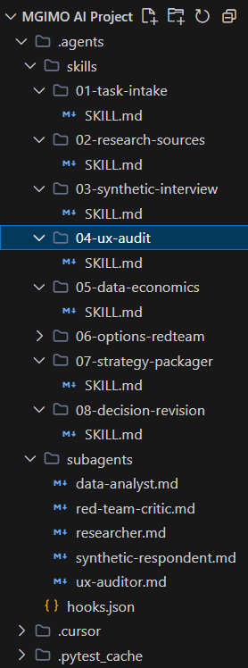
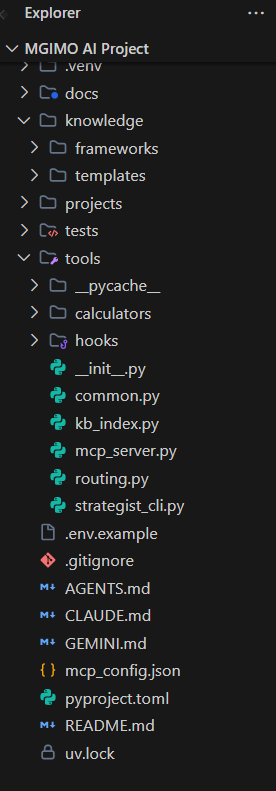
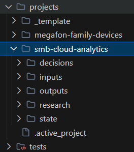
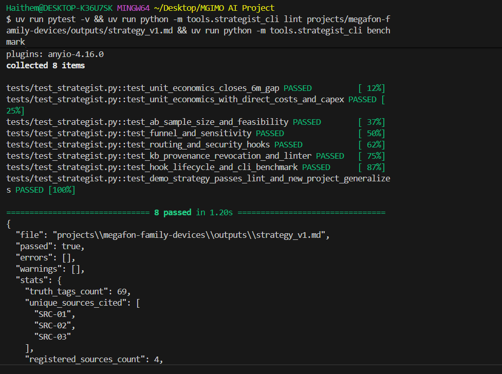
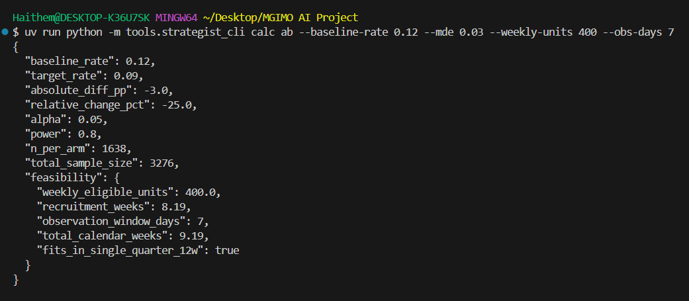
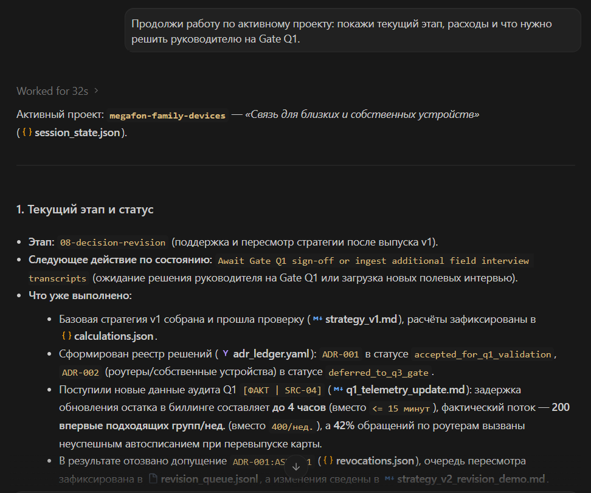
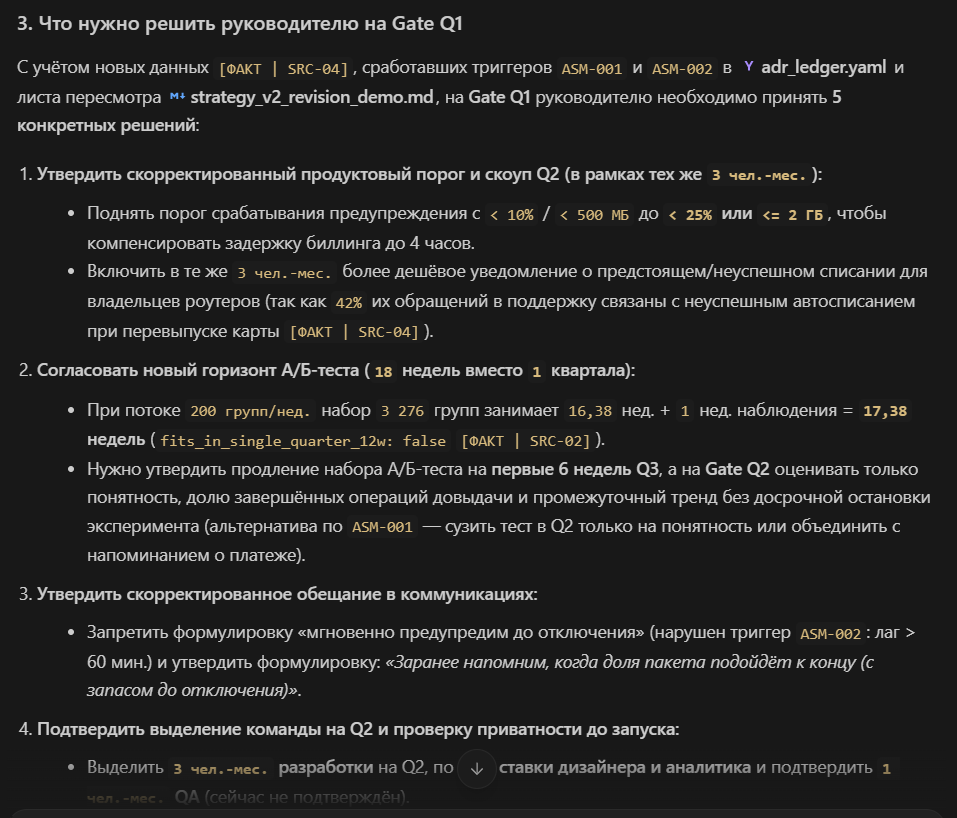
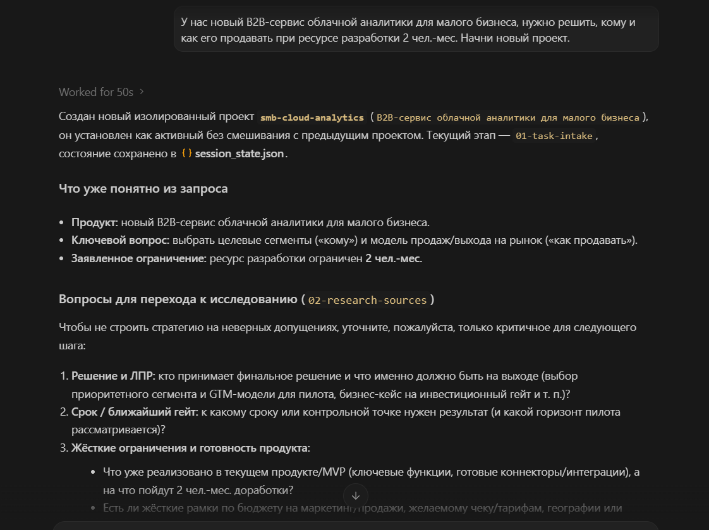
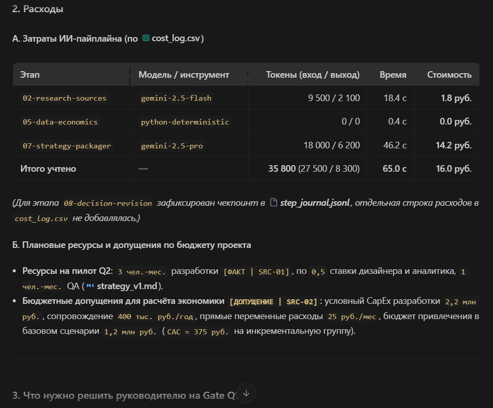
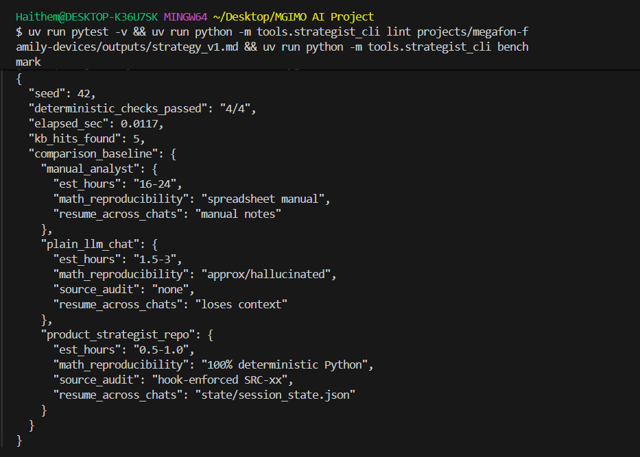

# Описание работы: ИИ-агент «Стратег Фабрики продуктов»

**Номинация:** ИИ-проект (MGIMO × AI Challenge) | **Кейс:** Фабрика Продуктов МегаФона («Связь для близких и собственных устройств»)

---

## 1. Архитектура агента: процессы, инструменты, контекст и знания

Репозиторий спроектирован по принципу **«размышление в LLM + детерминизм в Python»**. Это не монолитный чат-бот и не единый перегруженный промпт, а переносимая **ИИ-папка**, нативно работающая в Antigravity, Cursor, Claude Code и через CLI.

```text
[Запрос ПМ] ──> [Router: tools/routing.py]
                      │
      ┌───────────────┼───────────────┐
      ▼               ▼               ▼
[Fast Tier]    [Python CLI/MCP]  [Reasoning Tier]
Intake/PDF/    Math/AB/Funnel/   Options/Red-Team/
Interviews     KB/Lint/Cost      Strategy/Revision
      │               │               │
      └───────────────▼───────────────┘
        [Hooks: .agents/hooks.json]
    (Secret Guard + Step Journal + Resume)
```

### Жёсткое разделение 4 слоёв памяти и контекста
1. **Постоянные инструкции (`AGENTS.md`, `GEMINI.md`, `CLAUDE.md`, `.cursor/rules/`, `.agents/skills/*`, `.agents/subagents/*`):** определяют протокол работы, теги истинности и правила безопасности. Загружаются с **progressive disclosure** — полный текст навыка читается только на нужном этапе, экономя контекстное окно.
2. **Методические знания (`knowledge/frameworks/`, `knowledge/templates/`):** верифицированные стандарты юнит-экономики, дизайна А/Б-экспериментов и шаблоны документов.
3. **Материалы проекта (`projects/<slug>/inputs/`, `research/`, `decisions/`, `outputs/`):** изолированы по задачам (`_template` позволяет мгновенно стартовать любой новый продукт). Прежние выводы в `outputs/` индексируются БЗ с маркером `agent_output_UNVERIFIED` и предупреждением, чтобы агент никогда не принимал собственный старый текст за факт.
4. **Состояние текущей задачи (`projects/<slug>/state/`):** `session_state.json` (текущий этап, следующий шаг, пробелы), `step_journal.jsonl` (идемпотентный журнал вызовов инструментов) и `cost_log.csv` (учёт токенов, длительности и стоимости). Это обеспечивает **мгновенное продолжение работы в новом чате** без повтора завершённых шагов.

### Визуализация структуры репозитория (Antigravity IDE)
| Навыки, субагенты и хуки (`.agents/`) | Корень, методология и инструменты (`knowledge/`, `tools/`) | Изоляция проектов (`projects/`) |
|---|---|---|
|  |  |  |

---

## 2. Полный перечень моделей, сервисов и инструментов

| Компонент | Конкретная реализация | Для чего использован | Зачем вынесен отдельно (польза) |
|---|---|---|---|
| **Основная среда агента** | Antigravity IDE (совместима с Cursor / Claude Code / Codex) | Оркестрация навыков, субагентов, чтение файлов и выполнение команд | Работает как стандартная ИИ-папка без привязки к закрытой платформе |
| **Старшая модель рассуждений (`reasoning_tier`)** | Gemini 2.5 Pro / Claude Sonnet / GPT-4o (в среде Antigravity) | Синтез 3+ вариантов, Red-Team критика, сквозная 5-частная стратегия, пересмотр ADR | Используется только на сложных синтетических этапах (экономия токенов) |
| **Экономичная модель (`fast_tier`)** | Gemini 2.5 Flash / Haiku / GPT-4o-mini | Постановка задачи, извлечение сущностей, генерация гайдов и роли модельных респондентов | В ~5–10× дешевле для рутинных шагов без потери качества |
| **Детерминированные калькуляторы** | `tools/calculators/economics.py` (Python 3.11) | Баланс воронки, маржа 500 руб./мес, точка безубыточности, размер выборки A/B, сетка чувствительности | 0% арифметических галлюцинаций, единые единицы и знаменатели |
| **Маршрутизатор-классификатор** | `tools/routing.py` | Скоринг входного запроса и выбор навыка, субагента, уровня модели и fallback-плана | Исключает вызов дорогой модели там, где достаточно скрипта или `fast_tier` |
| **Локальная БЗ и отзыв записей** | `tools/kb_index.py` (BM25 + link-graph) | Поиск по формулировкам, смыслу и ссылкам `SRC-xx`/`ADR-xx`, отзыв устаревших записей (`revoke`) | Работает оффлайн за миллисекунды, без платных векторных БД |
| **MCP-сервер и CLI** | `tools/mcp_server.py` (MCPServer / FastMCP) + `tools/strategist_cli.py` | Единый интерфейс к статусу, чекпоинтам, калькуляторам, БЗ, линтеру и пересмотру | Полная воспроизводимость из терминала и IDE |
| **Экстрактор PDF и тесты** | `pypdf 7.1.1`, `pytest 9.2.0`, `uv 0.12.3` | Постраничное извлечение `primer_brifa.pdf` + сканер prompt-injection + автотесты (8/8) | Гарантия запуска «из коробки» по `README.md` |
| **Lifecycle-хуки** | `.agents/hooks.json` -> `tools/hooks/hook_runner.py` | `SessionStart` (инжект состояния), `PreToolUse` (блок секретов), `PostToolUse` (журнал шагов), `Stop` | Защита от утечек ключей и автоматическая прозрачность шагов |

---

## 3. Ключевые промпты и инструкции агента

1. **Протокол истинности (в `AGENTS.md` и `knowledge/frameworks/strategy_rubric.md`):** жёсткое требование помечать утверждения тегами `[ФАКТ | SRC-xx]`, `[ВИДНО В МАТЕРИАЛЕ]`, `[ГИПОТЕЗА]`, `[ДОПУЩЕНИЕ]`, `[ПРОГНОЗ]`, `[СИНТЕТИЧЕСКАЯ ГИПОТЕЗА]` и `[НЕДОСТАТОК ДАННЫХ]`, проверяемое автоматически линтером `tools/hooks/validators.py`.
2. **Обязательный выбор альтернатив и критика (`.agents/skills/06-options-redteam/SKILL.md` + `.agents/subagents/red-team-critic.md`):** запрет выдавать один «единственно верный» ответ — обязательны «Оставить как есть» и критерий остановки/закрытия направления с сильными возражениями.
3. **Защита от перехвата управления (`tools/common.py` + `AGENTS.md`):** любые инструкции, найденные внутри внешних сайтов или PDF-файлов, маркируются `sanitize_external_source` и не могут менять системные правила агента.
4. **Анти-галлюцинация модельных интервью (`.agents/subagents/synthetic-respondent.md`):** субагент-респондент намеренно инструктирован сопротивляться идее при нарушении приватности или наличии более простого привычного обхода, а результаты запрещено использовать как доказательство спроса.

---

## 4. Реализованные возможности дополнительного уровня

- **Интервью и модельные респонденты:** шаблон полевого гайда (`interview_guide_template.md`) + 3 контрастных синтетических интервью с семьями и владельцем роутера (`synthetic_interviews.md`).
- **Мультимодальность и UX-аудит:** навык `04-ux-audit` и субагент `ux-auditor.md` с правилом привязки к реально видимому в материале и проверкой крайних состояний (отзыв согласия, повторное списание).
- **Анализ данных:** воспроизводимые Python-модели воронки, А/Б-мощности с проверкой календарного темпа набора, границы безубыточности и чувствительности.
- **Поддержка решений и пересмотр при новых данных:** `decisions/adr_ledger.yaml` + команда `revise` + демонстрационный переход `strategy_v1.md` -> `strategy_v2_revision_demo.md` при поступлении новых данных Q1 (`SRC-04`).
- **Маршрутизация, Навыки, Хуки, Субагенты, MCP и CLI:** все 5 механизмов реализованы и связаны в единый контур.
- **База знаний с отзывом и разделением доверия:** `kb_index.py` с BM25 + графом ссылок и командой `kb revoke`.
- **Устойчивость к сбоям и переносимость:** идемпотентный `step_journal.jsonl`, fallback-правила в `routing.py`, точки входа под Antigravity, Cursor и Claude Code.
- **Сравнение с исходным способом:** воспроизводимая команда `strategist_cli benchmark` (`SEED=42`).

### Доказательства работы в терминале и в новых сессиях
**1. Автотесты (8/8), проверка цитат/фактов (`lint`) и детерминированные расчёты (`calc ab`):**





**2. Продолжение после перерыва в новом чате и учёт Gate Q1:**





**3. Проверка обобщаемости на совершенно новой задаче (B2B-аналитика для МСБ):**



---

## 5. Время, расходы на демо-проект, ошибки и помощь человека

### Зафиксированные затраты на демо-проект (`megafon-family-devices`)
*(Источник: `projects/megafon-family-devices/state/cost_log.csv`)*
- **Этап 02 (`fast_tier` + `pypdf`):** `9 500` input / `2 100` output токенов, `18,4 сек.`, `~1,80 руб.`
- **Этап 05 (`python-deterministic`):** `0` токенов LLM, `0,4 сек.`, `0,00 руб.` (все таблицы А/Б, воронки и прибыли!)
- **Этап 07 (`reasoning_tier`):** `18 000` input / `6 200` output токенов, `46,2 сек.`, `~14,20 руб.`
- **Суммарно на сквозной цикл (v1):** `35 800` токенов, `~65 сек.` чистого времени генерации/вычислений (`~35–45 мин.` вместе с проверкой человеком и уточнениями), **`~16,00 руб.`** расчётной стоимости API.

### Сравнение с исходными способами
| Способ | Время до готовой стратегии | Точность математики и выборки | Прозрачность источников | Продолжение после перерыва |
|---|---|---|---|---|
| **Аналитик вручную** | 16–24 часа | Высокая (ручные таблицы Excel) | Зависит от аккуратности | Ручные заметки |
| **Обычный чат с ИИ** | 1,5–3 часа | Часто путает знаменатели (например, `12% -> 9%` и `12 000` мес.) | Нет принудительной ссылки `SRC-xx` | Теряет нить в новом чате |
| **Наш агент (ИИ-папка)** | 0,5–1 час | 100% воспроизводимый Python | Линтер проверяет `SRC-xx` и теги фактов | Чекпоинты в `session_state.json` |





### Замеченные ошибки и роль человека в цикле
1. На первом прогоне линтера `strategist_cli lint` сработало предупреждение о несовпадении формулировки заголовка («стратегия проверки» вместо «план проверки») — словарь линтера и заголовок отчёта синхронизированы, после чего линтер прошёл без ошибок.
2. На этапе выбора между Вариантом B (лёгкий пилот) и Вариантом C (полный редизайн кабинета) агент остановился на развилке для подтверждения человеком жёсткого лимита Q2 в `3 чел.-мес.`.

---

## 6. Заявленные возможности и честные ограничения

- **Что агент делает уверенно:** структурирует размытый бриф, отделяет факты от гипотез, точно считает юнит-экономику/воронки/выборку A/B, генерирует контрастные альтернативы с сильными возражениями, согласовывает продуктовую и коммуникационную стратегии, сохраняет состояние для нового чата и пересматривает выводы при новых данных.
- **Ограничения:**
  1. Агент **не заменяет реальные интервью и реальный биллинг-аудит**: модельные интервью (`SRC-03`) дают только гипотезы; без выгрузки логов Q1 частоты причин остаются `[ДОПУЩЕНИЕ]`.
  2. Локальная БЗ использует лексический BM25 + граф ссылок `SRC-xx`/`ADR-xx` (без тяжёлых локальных эмбеддинг-моделей), чтобы репозиторий запускался за секунды без GPU.
  3. Учёт стоимости в `cost_log.csv` отражает зафиксированные прогоны через CLI/ручной учёт агента, так как не все IDE отдают биллинг токенов наружу через MCP.
